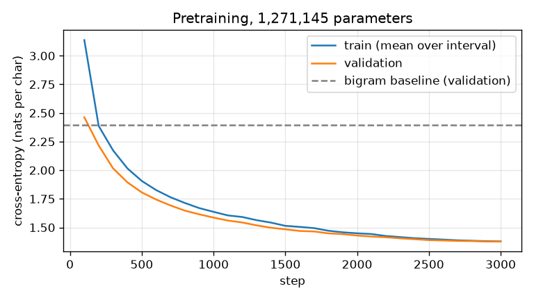

# tiny-transformer-evals

Attention and a decoder-only transformer written by hand in PyTorch, trained from scratch on
Danish text, and a reproducible eval harness that tests whether it really works: held-out
perplexity against a bigram baseline, capability evals with answer keys, robustness to noisy
and out-of-distribution input, supervised fine-tuning and DPO measured before and after, and
int8 quantization with its accuracy and latency cost.

It runs on a laptop CPU. The full run takes about 20 minutes on an Apple M1; the tiny config
that CI runs end to end takes under a minute. Every number below is rendered from a JSON file
in [`results/full/`](results/full/), and a test fails if the README and those files disagree.

## Quick start

```bash
uv sync
uv run python -m tte all --config configs/full.json
```

That pretrains the model, fits the bigram baseline, runs every eval on bigram, base, SFT and
DPO models, quantizes the final model and rewrites the tables below from the new results.
Single steps:

```bash
uv run python -m tte train --config configs/full.json
uv run python -m tte eval --config configs/full.json --checkpoint runs/full/base.pt --out results/full/eval_base.json
uv run python -m tte eval --config configs/full.json --checkpoint bigram
uv run python -m tte report --check
```

`eval` takes any checkpoint and writes one JSON file with every eval result and, next to each
number, what that eval does and does not measure.

## What is in the repository

| Part | File | What it does |
|---|---|---|
| Attention | [`tte/attention.py`](tte/attention.py) | Scaled dot-product attention, the causal mask (with a cache offset), multi-head self-attention with a key/value cache. No `nn.MultiheadAttention`, no `F.scaled_dot_product_attention`. |
| Model | [`tte/model.py`](tte/model.py) | Token embedding, sinusoidal positions, pre-LayerNorm blocks (attention and a GELU MLP with residual connections), final LayerNorm, output layer. Greedy decoding with and without the KV cache. |
| Explainer | [`docs/attention.md`](docs/attention.md) | Attention in plain words with the formula: why divide by sqrt(d), what the mask does, why multiple heads, why positions. |
| Data | [`tte/data.py`](tte/data.py), [`data/raw/`](data/raw/) | Four public domain Danish books from Project Gutenberg (about 1.2 MB of text), pinned by SHA-256. Split by blocks of 20 paragraphs: 8 blocks of every 10 for training, 1 for validation, 1 for test. Character tokenizer, 105 symbols. |
| Baseline | [`tte/bigram.py`](tte/bigram.py) | Character bigram model from counts with add-0.1 smoothing, fitted on the same training text. |
| Training | [`tte/train.py`](tte/train.py) | AdamW, linear warm-up then cosine decay, gradient clipping, fixed seed, loss curve saved as JSON and PNG. |
| Eval sets | [`tte/tasks.py`](tte/tasks.py), [`evals/`](evals/) | 1,500 items with answer keys, built deterministically from the test split and committed as JSONL so every item can be read. CI rebuilds them and fails on any difference. |
| Harness | [`tte/evals.py`](tte/evals.py) | One `Scorer` interface for both the transformer and the bigram, so both are scored by the same code. |
| SFT and DPO | [`tte/shaping.py`](tte/shaping.py) | SFT on a word reversal task mixed with language-model batches; DPO with on-policy preference pairs and a frozen reference model. |
| Inference | [`tte/quant.py`](tte/quant.py) | int8 dynamic quantization of every linear layer; latency at p50, p95 and p99 for prefill and for generation with and without the KV cache. |
| Report | [`tte/report.py`](tte/report.py) | Renders the tables below from `results/`; `--check` fails if they differ. |
| Configs | [`configs/full.json`](configs/full.json), [`configs/tiny.json`](configs/tiny.json) | Every setting of a run. |

## Results

<!-- results:start -->
Model: 1,271,145 parameters, trained for 3,000 steps (12,288,000 characters seen) in 852 s on `cpu`, torch 2.15.0. Source: `results/full/`.

**1. Pretraining from scratch vs the bigram baseline** (held-out test split, 114,432 characters; `eval_bigram.json`, `eval_base.json`)

| Metric | Bigram | Transformer |
|---|---|---|
| Test perplexity per character | 10.97 | 3.94 |
| Test bits per character (95% CI) | 3.455 (3.444 to 3.467) | 1.978 (1.960 to 1.998) |
| Word completion, exact match (n=400) | 0.0% | 30.2% |
| Minimal pairs, word order (n=300, chance 50%) | 33.3% | 93.0% |
| Minimal pairs, spelling (n=300, chance 50%) | 90.7% | 99.3% |

**2. Behaviour shaping: before and after, same harness** (`eval_base.json`, `eval_sft.json`, `eval_dpo.json`)

| Metric | Base | After SFT | After SFT + DPO |
|---|---|---|---|
| Reversal, 3 to 8 letters, exact match (n=300) | 0.0% | 91.3% | 95.7% |
| Reversal, 9 to 12 letters (unseen lengths), exact match (n=200) | 0.0% | 5.5% | 15.0% |
| Reversal, 9 to 12 letters, per-character accuracy | 2.5% | 35.9% | 43.5% |
| Test perplexity per character | 3.938 | 4.264 | 4.298 |
| Word completion, exact match | 30.2% | 28.2% | 27.5% |
| Minimal pairs, word order | 93.0% | 92.0% | 91.7% |

DPO used 229 preference pairs: the SFT model was wrong on 229 of the 1848 unseen training words it was asked to reverse (12.4%). Final training-batch reward accuracy 100.0% (`dpo_log.json`, pairs in `dpo_pairs.jsonl`).

**2b. How the DPO settings were chosen: pilot on validation words only** (`pilot_shaping.json`, 200 + 150 words from the validation split; rule: pick the candidate with the highest
in-distribution exact match on validation words; break ties on long words)

| Model | 3 to 8 letters, exact match | 9 to 12 letters, exact match | Mean length error, 3 to 8 letters |
|---|---|---|---|
| SFT only | 94.5% | 9.3% | -0.02 |
| Plain DPO, lr 0.0001 | 26.0% | 2.7% | +0.57 |
| Plain DPO, lr 1e-05 | 48.0% | 30.7% | +0.56 |
| DPO + NLL on chosen, lr 0.0001 | 90.5% | 4.0% | +0.07 |
| DPO + NLL on chosen, lr 3e-05 (chosen) | 90.5% | 16.7% | +0.09 |

**3. Robustness: bits per character, lower is better** (`eval_base.json`, `eval_bigram.json`)

| Input | Bigram | Transformer | Transformer change vs clean | Unknown chars |
|---|---|---|---|---|
| Clean test text | 3.455 | 1.978 |  |  |
| 5% of letters in the context replaced | 3.561 | 2.380 | +0.402 | 0.0% |
| 15% of letters in the context replaced | 3.766 | 3.111 | +1.133 | 0.0% |
| All lowercase | 3.497 | 2.535 | +0.557 | 0.0% |
| All uppercase | 9.921 | 5.516 | +3.539 | 0.0% |
| Other Danish author (Jacobsen, Fru Marie Grubbe) | 3.583 | 2.495 | +0.517 | 0.0% |
| English (Andersen in translation) | 5.035 | 6.039 | +4.062 | 0.4% |

**4. Inference: int8 dynamic quantization of the final model** (`quant.json`; CPU, 4 threads, engine qnnpack, 300 timed runs each, prompt 64 characters, 32 new tokens)

| Metric | fp32 | int8 dynamic |
|---|---|---|
| Weights on disk | 5.10 MB | 1.38 MB |
| Test perplexity per character | 4.298 | 4.300 |
| Reversal, 3 to 8 letters, exact match | 95.7% | 95.7% |
| Word completion, exact match | 27.5% | 28.5% |
| Prefill (one forward pass), p50 / p95 / p99 ms | 1.74 / 2.34 / 2.57 | 2.99 / 3.31 / 3.46 |
| Generate with KV cache, p50 / p95 / p99 ms | 22.70 / 24.66 / 25.95 | 40.00 / 42.31 / 45.06 |
| Generate without KV cache, p50 / p95 / p99 ms | 76.76 / 84.72 / 103.15 | 115.82 / 124.54 / 135.10 |
<!-- results:end -->



### What the results say

- **The transformer clearly beats the baseline it should beat.** On held-out text it needs about
  1.5 fewer bits per character than the bigram and the 95% intervals are far apart. Train and
  validation loss stay close together through the run and validation loss flattens over the last
  few hundred steps, so at this budget the model is limited by its size and data, not overfitting.
- **The capability evals separate what the bigram cannot do.** The bigram gets spelling pairs
  mostly right from letter statistics alone, but it is *below* chance on word order. Swapping two
  words changes only the letter pairs at the word boundaries, so the bigram can only judge those,
  and a likely reason it prefers the wrong order is that moving a word off the end of a sentence
  also moves the punctuation next to a space. I have not checked that further. The transformer, which sees whole words, gets word order right most of the
  time. Word completion stays modest: most misses are a different real word (`bedste` completed as
  `bedre`), which the single answer key counts as wrong.
- **Robustness has a sharp edge.** Random typos in the context and a different Danish author cost
  a little; all-uppercase text costs a lot, because capital letters in the training text almost
  only appear at the start of a word. On English the transformer is *worse than the bigram*: it is
  confidently wrong about a language it never saw, while the bigram, which only looks one letter
  back, has less to be wrong about. A lower perplexity in distribution says nothing about behaviour out of distribution.
- **SFT teaches the task; the cost shows up elsewhere.** The base model cannot reverse words at
  all (it just continues Danish). A few hundred SFT steps reach high exact match on words of the
  trained lengths, while held-out perplexity and word completion get slightly worse, even with
  language-model batches mixed in. That is the forgetting tax, and the harness measures it because
  every stage runs the same evals.
- **Length generalisation fails.** On 9 to 12 letter words, lengths never seen in SFT, exact match
  is low and the answers are on average more than two letters too short (`mean_length_error` in
  `eval_sft.json`): the model learned "answers are short", not "reverse the whole word".
- **DPO did not reliably help, and plain DPO hurt.** In the validation pilot (table 2b) plain DPO
  lowered in-distribution accuracy sharply and made answers too long. The model learned a
  shortcut from the pairs, because many rejected answers were too short, so "write more" raised the
  margin without solving the task. Adding a negative log-likelihood term on the chosen answer
  (the RPO variant) removed most of the damage but still did not beat SFT on validation. On the test
  set the chosen setting scored higher than SFT. Validation and test point in opposite directions
  by a few points on a few hundred words, so the honest reading is: no reliable gain from DPO here.
  The DPO training reward accuracy reached 100%, which shows why a training metric is not an eval.
- **int8 makes the model smaller, not faster, on this machine.** The weights shrink by about 3.7
  times and accuracy is unchanged, but on Apple silicon the qnnpack int8 kernels are slower than
  float32 for matrices this small, so latency went up. The KV cache matters far more for latency
  than quantization does. Tail latency (p95, p99) is much noisier than p50 on a laptop.

## What each eval measures, and what it does not

The same text is written into every results file next to the numbers (`descriptions` in
`eval_*.json`), so a number is never far from its caveat.

| Eval | Items | Measures | Does not measure |
|---|---|---|---|
| Held-out perplexity | the whole test split | Average next-character cross-entropy on paragraphs never trained on, as perplexity and bits per character, with a bootstrap 95% interval over windows. | Whether generated text is coherent or useful. Same books and spelling as training, so nothing about other domains. |
| Word completion | 400, answer key in [`evals/word_completion.jsonl`](evals/word_completion.jsonl) | Given 96 characters of held-out text and the first 3 letters of a word of 6 or more letters, does greedy decoding finish the word exactly? | Understanding. Frequent words and names repeated within a story are easy, and one gold answer marks plausible alternatives wrong. |
| Minimal pairs | 300 + 300, [`evals/minimal_pairs.jsonl`](evals/minimal_pairs.jsonl) | Does the model give a real sentence a higher likelihood than the same sentence with two adjacent words swapped (word order), or two adjacent letters swapped (spelling)? Chance is 50%. | Grammar in general; only these two local corruptions. |
| Reversal | 300 + 200, [`evals/reversal_in_dist.jsonl`](evals/reversal_in_dist.jsonl), [`evals/reversal_long.jsonl`](evals/reversal_long.jsonl) | Exact match on the SFT task: `vend:hest=` must give `tseh`. Words of 3 to 8 letters as in training, and 9 to 12 letters, a length never trained on. Eval words come from the test split and are removed from the training words. | Instruction following in general. It is one narrow synthetic task. |
| Robustness | the test split, perturbed; 2 other books | Bits per character when letters in the context are replaced at random (targets stay clean), when case changes, and on another Danish author and on English. | Adversarial robustness: the noise is random, not searched for. |

## Reproducibility

- **Seeds and settings fixed in a file.** Everything a run does is in [`configs/full.json`](configs/full.json):
  model size, steps, learning rates, batch sizes, smoothing of the bigram, number of eval items.
  `results/full/train_log.json` stores a copy of the config it was run with.
- **Deterministic on CPU.** `torch.use_deterministic_algorithms(True)`, a fixed thread count and
  seeded generators for batches, SFT words and DPO pairs. Running `tte all` twice on the same machine
  gives identical results files apart from wall-clock timings. Other CPUs or torch versions may give
  slightly different floating point results.
- **No tuning on the test split.** Pretraining and SFT settings were chosen before the first
  run. The DPO settings were chosen once by [`scripts/pilot_shaping.py`](scripts/pilot_shaping.py),
  which scores four candidates on words from the **validation** split only, with the selection
  rule written in the script before it ran; its output is [`results/full/pilot_shaping.json`](results/full/pilot_shaping.json).
  The test eval sets were used once, by the final run.
- **Eval sets are data, not code.** The 1,500 eval items with their answers are committed in
  [`evals/`](evals/). CI rebuilds them from the corpus and fails on any difference.
- **The README cannot drift.** The tables are rendered by `uv run python -m tte report` from
  `results/full/`. `tests/test_quant_and_report.py` and CI fail if they differ.
- **CI** ([`.github/workflows/ci.yml`](.github/workflows/ci.yml)): `uv sync --locked`, ruff, strict
  mypy, pytest, the eval set rebuild check, the tiny config through the whole pipeline (pretrain,
  bigram, every eval, SFT, DPO, int8), and the README check.
- **Hardware.** Results were produced on an Apple M1 CPU with 4 threads. The MPS backend of
  torch 2.15 crashed on this machine (macOS 14.4), so everything runs on CPU, which also keeps it
  deterministic. A first pretraining attempt ran three times slower than expected until
  `torch.set_flush_denormal(True)` was set; it is now on for every command.

## Limits

- **This is a tiny model, not an LLM.** About 1.27 million parameters, a 128-character context,
  character-level, trained for about 13 minutes on 1.2 MB of 19th century Danish. It learns
  spelling, frequent words and local word order. It does not know facts, follow instructions in
  general, or write coherent paragraphs.
- **No distributed or mixed precision training, no GPU.** Single process, float32, CPU. The
  techniques (pre-LN blocks, AdamW with warm-up and cosine decay, gradient clipping, SFT with
  masked loss, DPO with a reference model, KV cache, int8) are the same ones used at scale, but
  nothing here shows they were run at scale.
- **The SFT and DPO task is synthetic and narrow.** Reversing a word is chosen because it has an
  exact answer key and the base model cannot do it. Real preference data is noisy and comes from
  people; here the "preference" is simply correct over the model's own wrong answer.
- **Small eval sets.** With 300 items, one item is 0.3 percentage points and a 95% interval on an
  accuracy near 90% is roughly plus or minus 3.5 points. Differences smaller than that are noise.
  Each number comes from one training seed; no variance across seeds is reported.
- **Latency is for this machine.** p50, p95 and p99 are wall-clock times on one laptop with
  other programs running. Ratios between fp32 and int8 are more meaningful than the absolute
  milliseconds. Dynamic quantization only covers linear layers, and on a model this small the
  overhead of quantizing activations can cost more than the int8 matrix multiply saves.
- **Robustness is random noise only.** No adversarial search, no prompt injection, no red
  teaming of a model that has no instructions to subvert.
- **Old spelling.** The books use pre-1948 Danish orthography (`aa` for `å`, capitalised nouns),
  so the model's Danish is 19th century Danish.

## Data and license

Code: MIT, see [LICENSE](LICENSE). The texts in `data/raw/` are public domain Project Gutenberg
eBooks, kept unchanged with their Project Gutenberg headers:

| File | Book | Author | Use |
|---|---|---|---|
| `pg46278.txt` | Fra Mindebo: Jyske Folkeæventyr (1898) | Evald Tang Kristensen | training, validation, test |
| `pg13175.txt` | Ved Vejen (1886) | Herman Bang | training, validation, test |
| `pg10686.txt` | Tine (1889) | Herman Bang | training, validation, test |
| `pg51384.txt` | Lykke-Per, Første Del (1898) | Henrik Pontoppidan | training, validation, test |
| `pg44275.txt` | Fru Marie Grubbe (1876) | J. P. Jacobsen | out-of-distribution Danish only |
| `pg1597.txt` | Andersen's Fairy Tales (English translation) | H. C. Andersen | out-of-distribution English only |
